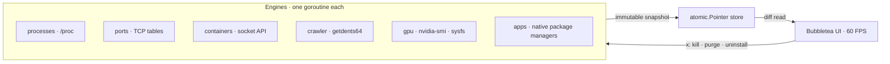

# vibe-check — dev machine monitor for the terminal

**htop + lsof + docker stats + ncdu + your package manager in one 60 FPS TUI — but with one keypress to
reclaim the RAM, disk and space your abandoned dev servers and half-removed apps left behind.**

[](https://github.com/gaurav-dhakal/vibe-check/actions/workflows/ci.yml)
[](https://github.com/gaurav-dhakal/vibe-check/releases/latest)
[](https://github.com/gaurav-dhakal/vibe-check/commits/main)
[](LICENSE)
[](#platforms)


*The clip is from 0.1.4 — the apps tab and the six-pane dashboard described below are newer than it.*

You keep asking the same four questions about your own machine: *what is eating CPU, what is holding
this port, what did I forget to kill, and where did my disk go.* `htop` answers one of them, `lsof`
answers another, and you do the joins by hand. `vibe-check` reads the kernel directly, answers all
four in one pane, and adds the part nobody else has: an action key. `x` kills the orphan, purges the
build junk, stops the container.

## New · an apps manager and a task manager in the same pane

### `6` — every installed app, and a way to get rid of it

One list of everything on the machine: **apt/dpkg, dnf/yum/rpm, pacman, snap, flatpak** and loose
**AppImages** on Linux; **brew formulae and casks** on macOS; **winget** on Windows — plus **npm
globals** and `.AppImage` files on all three, because those sit outside every manager's view. Size,
version, manager, description; `/` filters, `s` sorts. Then act:

| Key | Does |
|---|---|
| `⏎` | **browse the app's files** — every path it owns, per-folder file counts and byte sizes, totals, `y` copies a path |
| `x` | uninstall the app and leave your config and data alone |
| `X` | uninstall **and delete its files** — `apt purge`, `snap --purge`, `brew --purge`/`--zap`, `flatpak --delete-data`, `pacman -Rns` |
| `i` | **install from a file**: `.deb` · `.rpm` · `.tar.gz` · `.tar.xz` · `.AppImage` (macOS `.pkg` · `.dmg` · `.app` · `.zip`; Windows `.msi` · `.exe` · `.zip`) |
| `r` | re-read the managers |

Install an `.AppImage` through `i` and it is staged to `~/Apps`, marked executable and registered in
the desktop app tray — it launches like anything else you installed and turns up in this list again
tomorrow. Anything a manager wants root for goes through `pkexec` or `sudo -n`: one polkit prompt, and
it fails fast rather than hiding a password question behind the UI.

The list is **live**: a two-second fingerprint watch on the files a package operation really rewrites
(`/var/lib/dpkg/status`, the rpm/pacman databases, snapd state, the flatpak and brew folders, npm
globals, `~/Apps`) reloads it when something outside vibe-check changed them. Install in another
terminal and it shows up here without `r` — and the watch costs a handful of `stat` calls, never a
shell-out. `i` also takes `Ctrl+f` to open the desktop's own file chooser instead of typing a path —
on Linux that is the XDG desktop portal, the same request a browser makes, so COSMIC, GNOME and KDE
all hand back their native dialog even when `zenity` is not installed.

### …and the same actions as commands

Every key above has a non-interactive twin, so nothing needs the TUI — scripts, cron, SSH sessions
without a wide terminal, or just preferring the keyboard you already have:

| TUI | Command |
|---|---|
| `6` list · `/` filter | `vibe-check apps list [--filter snap] [--json]` |
| `⏎` files + stats | `vibe-check apps files <name> [--json]` |
| `x` uninstall | `vibe-check apps remove <name> --yes` |
| `X` uninstall + files | `vibe-check apps remove <name> --purge --yes` |
| `i` install from file | `vibe-check apps install ~/Downloads/app_1.2.3_amd64.deb` |
| badge `managers` | `vibe-check apps managers` |
| `b` drop page cache | `vibe-check boost` |
| `C` auto-clean toggle | `vibe-check autoclean on\|off` (writes config; `autoclean` alone shows it) |
| full snapshot | `vibe-check --json` |

`apps remove` refuses to run without `--yes`, and a name that matches several packages is an error
with the list, never a guess. Elevation behaves exactly as it does in the TUI: `pkexec` or `sudo -n`,
one prompt, no hidden password question.

### `1` — the dashboard is a task manager now

Six live panes; `h`/`l` selects, `f` zooms one to full size.

| Pane | What it shows |
|---|---|
| **cpu · per core** | total gauge, CPU model, core count and clock, then a history sparkline for every core |
| **memory** | gauge, used / available, swap, history |
| **disk · usage** | every real partition (tmpfs and overlay filtered out) with a usage bar, free and total bytes, and free space summed across mounts |
| **i/o · net** | read, write, down and up on auto-scaled charts, plus file-descriptor pressure |
| **gpu** / **runtime** | utilisation, VRAM and temp where a source exists; containers and listeners otherwise |
| **boost · clean** | the reclaim panel: orphans with the RAM they hold, junk above your threshold, and the key for each |

| Key | Does |
|---|---|
| `c` | **boost & clean sweep** — kill orphans, purge the junk list, drop the page cache, after listing exactly what it will do |
| `C` | toggle **auto-clean**: unattended purge of build junk at or above `auto_clean_junk_mb` (256 MB) every minute, saved to config |
| `b` | drop the kernel page cache so the free-RAM number is honest — elevated, Linux and macOS |

### And it stays small

The package inventory is the biggest single thing vibe-check ever holds, so it is read only when you
open the apps tab and released about a minute after you leave it. History is sampled into a reusable
buffer with no per-frame allocation, the file walk behind `⏎` is capped and superseded the instant you
select another app, and the runtime collects eagerly (`GOGC=40`) against a 96 MB soft limit.

Measured just now on a 2,427-package dev machine, 8 cores, sampled from `smaps_rollup` and
`/proc/pid/stat` through a real PTY:

| | private memory | CPU |
|---|---|---|
| dashboard idle | 5.5–7.0 MB | ~4.7% of one core (0.6% of the machine) |
| reading the inventory once | 7.6 MB peak | ~22% of one core for ~5 s |
| apps tab held open | 6.2–7.1 MB | ~4.2% of one core |

Total RSS reads ~16 MB, but `smaps_rollup` says only ~6 MB of that is private anonymous memory — the
rest is the mapped 9 MB binary, clean pages the kernel drops under pressure. In other words,
vibe-check costs less RAM than the dev server it is watching, and uses less CPU than the `ls` it
replaced.

## Install (30 seconds)

Pick one — they all land the same static binary.

**macOS · Linux (Recommended)**

```sh
curl -fsSL https://raw.githubusercontent.com/gaurav-dhakal/vibe-check/main/install.sh | bash
```

**Homebrew (macOS · Linux)**

```sh
brew tap gaurav-dhakal/vibe-check
brew install vibe-check
```

**Windows (Recommended — PowerShell)**

```powershell
irm https://raw.githubusercontent.com/gaurav-dhakal/vibe-check/main/install.ps1 | iex
```

**WinGet (Windows)**

```powershell
winget install gaurav-dhakal.vibe-check
```

Then run it:

```sh
vibe-check          # the TUI
vcheck --json       # one snapshot, pipe-friendly
```

The **first launch only** asks for a theme instead of guessing — answer once and it never asks again:

```
  ● vibe-check — first run
  pick a theme:
    1) catppuccin   Catppuccin Mocha   (default)
    2) tokyonight   Tokyo Night
    3) gruvbox      Gruvbox Dark
    4) nord         Nord Snow Storm
    5) dracula      Dracula
    6) solarized    Solarized Dark
```

Type a number, or just press enter. Prefer to skip the interview?

```sh
vibe-check --default          # install with the stock settings, nothing asked
vibe-check --theme dracula    # or name it up front
```

The answer is written to `~/.config/vibe-check/config.toml`, so later launches just open the dashboard.
To restyle while it is running, press `t` — it cycles all six themes live and saves the one you land
on, rewriting only the `theme` line so your other settings and comments stay put.

### Uninstall

```sh
vibe-check uninstall          # or: vcheck --uninstall
```

Removes the `vibe-check` and `vcheck` binaries next to the running one, plus the config directory,
after asking first (`--yes` for scripts). If Homebrew or winget owns the install, it says so and
hands you the right `brew uninstall` / `winget uninstall` instead of deleting files behind their back.

No Go required, no admin rights, no telemetry, no self-updater. Every installer verifies downloads
against the release's `checksums.txt`. The `winget` package goes live as soon as Microsoft's
validation merges it; `go install github.com/gaurav-dhakal/vibe-check@latest` works meanwhile.
More options and troubleshooting: [docs/configuration.md](docs/configuration.md).

## Why not just htop?

| | **vibe-check** | htop / btop | lsof / ss | docker stats | ncdu |
|---|---|---|---|---|---|
| Live CPU · RAM · I/O dashboard | ✔ | ✔ | — | — | — |
| Per-core charts · partition usage · reclaim panel | ✔ | partial | — | — | — |
| Orphaned dev servers + reclaimable RAM | ✔ | — | — | — | — |
| Port → owning process, with HTTP health | ✔ | — | manual | — | — |
| Build-junk sizes + one-key purge | ✔ | — | — | — | browse only |
| Containers without an SDK or CLI | ✔ | — | — | ✔ | — |
| Every installed app, its files, and uninstall | ✔ | — | — | — | — |
| Headless JSON for scripts | ✔ | — | ✔ | — | — |

htop shows processes. vibe-check shows your machine.

## What you get

| | |
|---|---|
| **Orphan detector** | dev servers reparented to PID 1, flagged with the RAM they hold; sweep them all from the command palette |
| **Port mapper** | kernel TCP table → owning PID → synthetic HTTP HEAD probe, so `3000` shows `200 · 3.6ms`, not just `LISTEN` |
| **Artifact crawler** | byte-exact sizes for `node_modules`, `target`, `.next`, `.venv`… capped at a fraction of a core |
| **Container view** | Docker/Podman over the raw socket — no SDK, no CLI dependency |
| **Apps inventory** | every package from every manager on your OS, plus AppImages and npm globals, with per-app file listings |
| **Uninstall & install** | `x` removes the app, `X` removes the app *and* its files; `i` installs from `.deb`, `.rpm`, `.AppImage`, archives |
| **Reclaim panel** | orphans, oversized build junk and the page cache in one pane, each with its own key |
| **GPU pane** | utilisation, VRAM and temperature from `nvidia-smi` or sysfs — the runtime pane stays when the machine has no readable GPU |
| **Kill & purge** | `x` acts on the selected row; purge asks first and only ever touches what the crawler listed |
| **Headless mode** | `--json` for CI, cron and `jq` |

## How it works



Collectors never block the UI, and the UI never invents a number — when a platform has no source for
a metric, you get a dash. The apps collector is the exception to the cadence: it shells out to your
package managers once when you open the tab, never on a timer, because that read is too heavy for one.
Deep dive: [docs/architecture.md](docs/architecture.md).

## Real usage

```sh
# who owns port 3000, and is it answering HTTP?
vcheck --json | jq '.ports[] | select(.port == 3000)'

# how many bytes are rotting in orphaned dev servers?
vcheck --json | jq '[.procs[] | select(.orphan)] | map(.rss) | add'

# the ten biggest node_modules directories on disk
vcheck --json | jq -r '.artifacts[] | select(.kind == "node_modules")
  | "\(.size)\t\(.path)"' | sort -rn | head
```

```toml
# ~/.config/vibe-check/config.toml — the keys people actually set
theme         = "tokyonight"   # catppuccin · tokyonight · gruvbox · nord · dracula · solarized
watch_ports   = [3000, 5173, 8080]
ram_alert_pct = 90
```

Power keys: `1`–`6` tabs · `/` filter · `o` orphans only · `x` act · `⏎` app files · `c` boost & clean ·
`Ctrl+p` palette · `t` theme.
Full keymap: [docs/keyboard.md](docs/keyboard.md) · full config: [docs/configuration.md](docs/configuration.md).

## Why this exists

I kept doing the 3 a.m. ritual: fan screaming, `htop` full of `node` processes I couldn't name, and no
cheap way to tell which were load-bearing and which were leftovers from a branch I deleted last week.
Every tool answered exactly one question — processes, ports, disk — and the joins were my problem. I
wanted one pane that answers all four and lets me *act* from the keyboard. The honesty rule — a dash
beats an estimate — came from being burned by tools that guessed.

## Platforms

| Linux | macOS | Windows |
|---|---|---|
| full `/proc` fast path | gopsutil collectors | no `netstat`, Docker over named pipe |
| apt · dnf/yum · rpm · pacman · snap · flatpak | brew formulas + casks | winget |
| AppImages, npm globals | AppImages, npm globals | AppImages, npm globals |
| file picker: XDG portal → zenity/kdialog | file picker: `osascript` panel | file picker: shell dialog |

CI builds, tests **and runs** the headless snapshot on every OS — collected, not asserted.
[docs/development.md](docs/development.md).

## FAQ

**Is it free?** MIT, no pro tier, no account, no nagging.
**Does it call home?** No. The only network traffic is HEAD probes to sockets already listening on your machine. No analytics, no update checks.
**How much CPU does it cost?** 2.8–4.2% of one core at steady idle; the first disk crawl peaks around 27% for ten seconds.
**How much memory does it hold?** 1–2 MB of live heap; ~6 MB of private anonymous memory at steady state, the rest of its RSS being the mapped binary. The installed-app inventory is released a minute after you leave the tab.
**Can purge delete the wrong thing?** It confirms first and only ever targets directories the crawler itself listed.
**Can it uninstall something by accident?** Every uninstall and install is a key you pressed, on a row you selected, with the manager's exact command shown first — and `X`, the one that also deletes config and data, says so in its own title.
**Does installing need root?** Only where the manager needs it: `.deb`/`.rpm`/`apt`/`dnf`/`pacman`/`snap` calls go through `pkexec` or `sudo -n`. AppImage staging and per-user managers (flatpak, brew, npm) run as you.
**Why not btop + a few scripts?** btop is a better process viewer. Nothing else gives you port→process→HTTP health and one-key artifact purge in the same pane.
**Where are my GPU stats?** NVIDIA (via `nvidia-smi`) and AMD (via sysfs) swap the runtime pane for a GPU pane. Intel iGPUs expose no cheap utilisation counter, so the runtime pane stays — a dash beats an estimate.
**Is it maintained?** Actively: CI on every push, tagged releases, issue templates answered.

## Security & privacy

`vibe-check` runs as you and can do what you can do: signal processes, delete listed directories,
uninstall packages through your own manager and install a file you point it at. Root is borrowed only for
manager commands that require it, via `pkexec`/`sudo -n` — never a prompt the UI can't show you. Nothing
leaves your machine. Purge and uninstall confirm first; container control is start/stop over the local
socket. Full capability and blast-radius table in [SECURITY.md](SECURITY.md).

## Contributing

Fork → branch → `make lint test race` → PR. Use the issue templates, or pick a
[`good first issue`](https://github.com/gaurav-dhakal/vibe-check/labels/good%20first%20issue).
Ground rules in [CONTRIBUTING.md](CONTRIBUTING.md); release history in [CHANGELOG.md](CHANGELOG.md).

## Star history

[](https://star-history.com/#gaurav-dhakal/vibe-check&Date)

If vibe-check just found the orphan eating your RAM, **a star** helps the next developer find this
repo the same way.

## About

**Vibecoded.** This project was built pair-programming with an AI agent.

MIT licensed, see [LICENSE](LICENSE).
