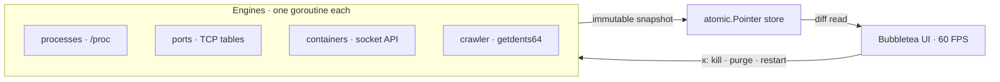

# vibe-check — dev machine monitor for the terminal

**htop + lsof + docker stats + ncdu in one 60 FPS TUI — but with one keypress to reclaim the RAM and
disk your abandoned dev servers left behind.**

[](https://github.com/gaurav-dhakal/vibe-check/actions/workflows/ci.yml)
[](https://github.com/gaurav-dhakal/vibe-check/releases/latest)
[](https://github.com/gaurav-dhakal/vibe-check/commits/main)
[](LICENSE)
[](#platforms)


You keep asking the same four questions about your own machine: *what is eating CPU, what is holding
this port, what did I forget to kill, and where did my disk go.* `htop` answers one of them, `lsof`
answers another, and you do the joins by hand. `vibe-check` reads the kernel directly, answers all
four in one pane, and adds the part nobody else has: an action key. `x` kills the orphan, purges the
build junk, stops the container.

## Install (30 seconds)

| Platform | Command |
|---|---|
| macOS · Linux | `brew tap gaurav-dhakal/vibe-check && brew install vibe-check` |
| Windows | `winget install gaurav-dhakal.vibe-check` |
| Termux · curl | `curl -fsSL https://raw.githubusercontent.com/gaurav-dhakal/vibe-check/main/install.sh \| bash` |

```sh
vibe-check          # the TUI
vcheck --json       # one snapshot, pipe-friendly
```

No Go required, no admin rights, no telemetry, no self-updater. Every installer verifies downloads
against the release's `checksums.txt`. The `winget` package goes live as soon as Microsoft's
validation merges it; `go install github.com/gaurav-dhakal/vibe-check@latest` works meanwhile.

## Why not just htop?

| | **vibe-check** | htop / btop | lsof / ss | docker stats | ncdu |
|---|---|---|---|---|---|
| Live CPU · RAM · I/O dashboard | ✔ | ✔ | — | — | — |
| Orphaned dev servers + reclaimable RAM | ✔ | — | — | — | — |
| Port → owning process, with HTTP health | ✔ | — | manual | — | — |
| Build-junk sizes + one-key purge | ✔ | — | — | — | browse only |
| Containers without an SDK or CLI | ✔ | — | — | ✔ | — |
| Headless JSON for scripts | ✔ | — | ✔ | — | — |

htop shows processes. vibe-check shows your machine.

## What you get

| | |
|---|---|
| **Orphan detector** | dev servers reparented to PID 1, flagged with the RAM they hold; sweep them all from the command palette |
| **Port mapper** | kernel TCP table → owning PID → synthetic HTTP HEAD probe, so `3000` shows `200 · 3.6ms`, not just `LISTEN` |
| **Artifact crawler** | byte-exact sizes for `node_modules`, `target`, `.next`, `.venv`… capped at a fraction of a core |
| **Container view** | Docker/Podman over the raw socket — no SDK, no CLI dependency |
| **Kill & purge** | `x` acts on the selected row; purge asks first and only ever touches what the crawler listed |
| **Headless mode** | `--json` for CI, cron and `jq` |

## How it works



Collectors never block the UI, and the UI never invents a number — when a platform has no source for
a metric, you get a dash. Deep dive: [docs/architecture.md](docs/architecture.md).

## Real usage

```sh
# who owns port 3000, and is it answering HTTP?
vcheck --json | jq '.ports[] | select(.port == 3000)'

# how many bytes are rotting in orphaned dev servers?
vcheck --json | jq '[.procs[] | select(.orphan)] | map(.rss) | add'

# the ten biggest node_modules directories on disk
vcheck --json | jq -r '.artifacts[] | select(.kind == "node_modules")
  | "\(.size)\t\(.path)"' | sort -rn | head
```

```toml
# ~/.config/vibe-check/config.toml — the keys people actually set
theme         = "tokyonight"          # catppuccin | tokyonight | gruvbox
watch_ports   = [3000, 5173, 8080]
ram_alert_pct = 90
```

Power keys: `1`–`5` tabs · `/` filter · `o` orphans only · `x` act · `Ctrl+p` palette · `t` theme.
Full keymap: [docs/keyboard.md](docs/keyboard.md) · full config: [docs/configuration.md](docs/configuration.md).

## Why this exists

I kept doing the 3 a.m. ritual: fan screaming, `htop` full of `node` processes I couldn't name, and no
cheap way to tell which were load-bearing and which were leftovers from a branch I deleted last week.
Every tool answered exactly one question — processes, ports, disk — and the joins were my problem. I
wanted one pane that answers all four and lets me *act* from the keyboard. The honesty rule — a dash
beats an estimate — came from being burned by tools that guessed.

## Platforms

| Linux | macOS | Windows | Termux |
|---|---|---|---|
| full `/proc` fast path | gopsutil collectors | no `netstat`, Docker over named pipe | static arm64 build; some metrics need `tsu` |

CI builds, tests **and runs** the headless snapshot on every OS — collected, not asserted.
[docs/development.md](docs/development.md).

## FAQ

**Is it free?** MIT, no pro tier, no account, no nagging.
**Does it call home?** No. The only network traffic is HEAD probes to sockets already listening on your machine. No analytics, no update checks.
**How much CPU does it cost?** 2.8–4.2% of one core at steady idle; the first disk crawl peaks around 27% for ten seconds.
**Can purge delete the wrong thing?** It confirms first and only ever targets directories the crawler itself listed.
**Why not btop + a few scripts?** btop is a better process viewer. Nothing else gives you port→process→HTTP health and one-key artifact purge in the same pane.
**Does it work on Termux?** Yes — the dashboard and disk crawl run out of the box; Android hides other processes' `/proc` from unprivileged apps, so ports and orphans need root.
**Is it maintained?** Actively: CI on every push, tagged releases, issue templates answered.

## Security & privacy

`vibe-check` runs as you and can do what you can do: signal processes, delete listed directories.
Nothing leaves your machine. Purge confirms; container control is start/stop over the local socket.
Full capability and blast-radius table in [SECURITY.md](SECURITY.md).

## Contributing

Fork → branch → `make lint test race` → PR. Use the issue templates, or pick a
[`good first issue`](https://github.com/gaurav-dhakal/vibe-check/labels/good%20first%20issue).
Ground rules in [CONTRIBUTING.md](CONTRIBUTING.md); release history in [CHANGELOG.md](CHANGELOG.md).

## Star history

[](https://star-history.com/#gaurav-dhakal/vibe-check&Date)

If vibe-check just found the orphan eating your RAM, **a star** helps the next developer find this
repo the same way.

## About

**Vibecoded.** Built pair-programming with an AI agent (Qoder) across engine, UI, packaging and CI —
with humans making the calls on architecture, naming and "no, that number has to be real."
MIT licensed, see [LICENSE](LICENSE).
