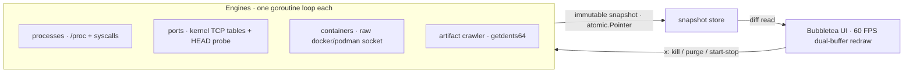

# Architecture

Two loops, deliberately decoupled: collectors write snapshots through `atomic.Pointer`, the UI reads
snapshots and redraws on a diff basis across a dual buffer, so an idle screen issues almost no writes
and cannot flicker. Panes repaint at up to 60 FPS without collecting anything.

## The engines

Each one is a goroutine loop that publishes an immutable snapshot; the UI never blocks on collection.

**Orphan and leak detector** — dev servers reparented to PID 1, or whose parent vanished, are flagged
with the RSS you can reclaim. `x` kills the selected row; `Ctrl+p` → *kill all orphaned dev servers*
does the sweep. Newly reparented daemons are ignored until they clear `orphan_min_age_sec` and
`orphan_min_rss_mb`, so the list stays honest instead of noisy.

**Artifact crawler** — walks your home directory for `node_modules`, `target`, `.next`, `.venv`,
`dist`, `build`, `out`, `.turbo`, `.parcel-cache`. On Linux it decodes `getdents64` directly with zero
per-entry allocation and shares one duty-cycle limiter across its workers, so it is capped at a fraction
of a core no matter how many directories it opens. Results publish incrementally. Sizes are
hardlink-aware and byte-exact against `du --apparent-size`. `x` hands a directory to a concurrent purge
engine that reports progress and emits events.

**Port mapper** — reads the kernel's TCP listener table (on Linux, `/proc/net/tcp` and `tcp6`, with
socket inodes resolved to owning PIDs through a cached `/proc/*/fd` walk), maps `watch_ports` that are
not bound as explicitly *not bound*, and probes listeners with a non-blocking synthetic HTTP HEAD —
TLS sniffing included — so `3000` shows status and latency rather than just `LISTEN`.

**Container view** — talks to Docker or Podman over the raw unix socket (named pipe on Windows, with
Colima and `~/.docker` endpoints discovered) and streams per-container stats. No SDK, no CLI dependency,
no daemon-restart cleverness.

**GPU collector** — `nvidia-smi --query-gpu=…` when the NVIDIA driver is installed on any OS, otherwise
the AMD sysfs surface (`/sys/class/drm/card*/device/gpu_busy_percent`, `mem_info_vram_*`, and a hwmon
temperature). A card with no utilisation file is skipped rather than guessed at, so Intel iGPUs leave
the runtime pane in place; the dashboard swaps that pane for GPU stats only when a source exists.

**FD and I/O pressure** — `/proc/sys/fs/file-nr` against the system limit, plus per-process FD sampling
that only reads what changed since the last tick.

**Terminal recovery** — the alternate screen, cursor and attributes are restored on clean quit, on
`SIGINT`, `SIGTERM` and `SIGHUP`, and from a recovered panic inside the UI. A killed `vibe-check` never
leaves your shell in a broken state.

## Accuracy

The claim is boring and deliberate: a number is shown only when the kernel or API supplied it.

- Artifact bytes and file counts are byte-exact against `du --apparent-size` and `find | wc`, including
  hardlink deduplication — pinned by tests that build a directory tree with spaces, unicode, empty dirs,
  symlinks, loops and absolute links.
- `num_cpu`, `mem_total`, `hostname`, `fd_max`, listener count and `load_1` are cross-checked against
  `nproc`, `/proc/meminfo`, `/proc/sys/fs/file-nr`, `ss -ltn` and `/proc/loadavg`.
- Counts that legitimately drift between two samplings (process total, available memory, uptime) are
  explained by sampling time, not fudged into agreement.
- When a platform has no source for a metric, the UI renders a dash. It does not substitute an estimate.

## Performance

Measured on an 8-core Linux laptop, in 10-second CPU buckets of a live run: **27%** of a core during the
first ten seconds while the initial crawl runs (higher on a cold page cache), then **2.8–4.2%** at steady
idle. `--json` runs the crawl unthrottled and returns a complete snapshot in about **1.6 s**.
